# 무한의 계란 (Infinite Egg) - UI/아트 전용 세션 아키텍처 및 디자인 명세서
> **문서 목적**: 메인(엔진/로직) 세션에서 `fork`하여 분기될 **UI/아트 전용 세션**이 별도의 추가 설명 없이 즉시 전체 구조를 이해하고, 일관된 디자인 시스템과 테마를 구축하여 컴포넌트를 리디자인할 수 있도록 정의된 마스터 설계 규격서입니다.

---

## 1. 프로젝트 비전 및 아트 목표 (Visual Target)

### 1.1 핵심 문제의식
- 기존 UI는 기능 구현 중심의 '패치형 수정'으로 인해 단순 웹페이지나 조각조각 모아둔 일러스트 같은 산만함이 남아있었습니다.
- **목표**: **'브롤스타즈(Brawl Stars)'**의 묵직하고 완성도 높은 3D 볼륨감, **'운빨존많겜'**의 오밀조밀하고 꽉 찬 화면 밀도, 그리고 **'무한의 계단'**의 직관적이고 경쾌한 아케이드 감성을 융합한 **전문 모바일 아케이드 게임 룩앤필**을 확립합니다.

### 1.2 디자인 4대 절대 원칙 (Design Iron Rules)
1. **화면 밀도 극대화 (Zero Dead Space)**:
   - 휑한 여백이나 단순 플랫 배경을 배제하고, 장식 프레임, 스포트라이트, 패턴, 입체 섀도우로 빈틈없이 밀도 높은 화면을 구성합니다.
2. **시인성 100% 보장 (Contrast & Stroke Guarantee)**:
   - 밝은 배경(노란색, 흰색, 에메랄드 등) 위에 흰색이나 연한 글자가 올라가는 실수를 원천 차단합니다.
   - 모든 주요 버튼과 텍스트에는 1.5px 다크 스트로크(`-webkit-text-stroke`)와 360도 입체 섀도우를 부여하거나, 고대비 다크 텍스트(`#1e1b18`)를 적용하여 10:1 이상의 명도 대비를 상시 유지합니다.
3. **만지고 싶은 3D 볼륨 손맛 (Tactile Chunky Arcade)**:
   - 모든 버튼과 인터랙티브 카드는 4~5px의 묵직한 하단 섀도우 뎁스(`box-shadow: 0 5px 0 ...`)를 가지며, 터치(`active`) 시 3~4px 하강하는 기계식 아케이드 스위치 모션을 탑재합니다.
4. **Zero-Asset 100% 코드 기반 렌더링 유지**:
   - 단일 파일 배포본(`infinite-egg.html`, ~470KB) 규격을 유지하기 위해 무거운 외부 래스터 이미지(PNG, JPG) 대신 **순수 인라인 SVG와 Canvas 2D, Pure CSS**만으로 고퀄리티 그래픽을 표현합니다.

---

## 2. 세션 간 역할 분업 규약 (Contract & Interface)

```mermaid
flowchart LR
    subgraph EngineSession ["메인 엔진 세션 (Logic & Core)"]
        Physics["물리 엔진 & 각도 연산\n(gameEngine.ts)"]
        MapGen["절차적 맵 생성기\n(mapGenerator.ts)"]
        Storage["데이터 저장/동기화\n(storage.ts)"]
        SoundSynth["Web Audio 신디사이저\n(sound.ts)"]
        Build["단일 파일 빌드 & 릴리즈\n(infinite-egg.html)"]
    end

    subgraph InterfaceContract ["세션 간 공유 규약 (Interface / Props Contract)"]
        Tokens["디자인 시스템 토큰 (index.css)"]
        Props["컴포넌트 Props & Enum (game.ts)"]
        SVGLayers["일러스트 레이어 규격 (EggIllustration)"]
    end

    subgraph UISession ["분기된 UI 세션 (Art & Visuals)"]
        Theme["비주얼 테마 확립 (팔레트, 폰트)"]
        Components["화면/컴포넌트 리디자인 (Tabs, Modals)"]
        Tactile["3D 섀도우 & 인터랙션 모션"]
        InGameVisuals["캔버스 도로 텍스처 & 특수 이펙트"]
    end

    EngineSession <--> InterfaceContract <--> UISession
```

- **메인 엔진 세션**: 인터페이스 정의(`Props`), 상태 관리(`UserProgress`, `GameStats`), 물리/좌표 연산, 게임 루프, 단일 파일 빌드 및 최종 배포 전담.
- **UI/아트 세션**: 디자인 토큰(`index.css`), 컴포넌트 뷰 스타일링, SVG 일러스트 패스, 인터랙션 애니메이션 및 비주얼 테마 구현 전담.

---

## 3. UI 컴포넌트 7대 그룹 상세 명세 (Component Catalog)

### Group 1. 인게임 월드 & 트랙 (In-Game World & Track)
| 컴포넌트 | 소스 파일 위치 | 로직 전달 데이터 (Props) | UI 세션 디자인 핵심 과제 |
| :--- | :--- | :--- | :--- |
| **Road Slope** | `src/game/eggRenderer.ts`, `mapGenerator.ts` | `RoadSegment` (좌표, 너비, 각도, 바이옴) | 6대 바이옴별 도로 상판 텍스처(얼음 빙판, 잔디벽돌, 네온, 현무암) 및 3D 두께 측면 음영 |
| **Road Corner** | `src/game/eggRenderer.ts` | `CornerJoint` (코너 중심, 회전각) | 코너 회전부의 자연스러운 곡률 베벨, 바깥쪽 낭떠러지 위험 단차 표현 |
| **Road Gap** | `src/game/mapGenerator.ts` | `gapDistance` (92~140px) | 도약 지점과 착지 런웨이의 노란/검정 아케이드 경고 스트라이프 마킹 |
| **Cracked Road** | `src/game/gameEngine.ts` | `isCracked`, `collapseTimer` | 밟았을 때 거미줄처럼 쩍쩍 갈라지는 입체 균열 및 돌 파편 붕괴 애니메이션 |
| **Skid Trail** | `src/game/gameEngine.ts` | `trailRingBuffer` (좌표, 알파) | 신선한 계란 흰자의 촉촉한 윤기 타원 및 스킨별 고유 오라(불꽃, 슬라임, 성광) |
| **Bandage Prop** | `src/game/eggRenderer.ts` | `x, y, collected` | 파스텔톤 의료용 십자 반창고 3D 렌더링, 둥실둥실 떠오르는 부유 모션 |
| **Parallax Sky** | `src/game/eggRenderer.ts` | `cameraY`, `biomeType` | 설산 롯지, 폭포수, 풍차, 수정 기둥, 화산암 등 깊이감 있는 3중 패럴랙스 랜드마크 |

---

### Group 2. 계란 캐릭터 & 코스튬 (Egg Cosmetics)
| 컴포넌트 | 소스 파일 위치 | 로직 전달 데이터 (Props) | UI 세션 디자인 핵심 과제 |
| :--- | :--- | :--- | :--- |
| **EggIllustration** | `src/components/common/EggIllustration.tsx` | `skin`, `equippedCostumes`, `expression` | 100% SVG 기반 1:1 캐릭터 일러스트. 3D 구형 음영, 스튜디오 반사광, 감정 표정선 |
| **CostumeSvgLayers** | `src/components/home/CostumeSvgLayers.tsx` | `hatId`, `topId`, `bottomId`, `handId` | 모자, 제복, 바지, 손 소품 레이어링. 입/얼굴을 가리지 않는 완벽한 위계 정렬 |
| **Wing Special Layers** | `EggIllustration.tsx`, `eggRenderer.ts` | `bundledCostumes.hat/back` | 천사란(3단 깃털 결, 황금 림), 악마란(박쥐 뼈대 골격 및 검붉은 피막) 전문 일러스트 |
| **In-Game Egg Crack** | `src/game/eggRenderer.ts` | `hpRatio` (1.0 ~ 0.0) | 캔버스 상에서 달걀 껍질이 실시간으로 금가고 노른자가 깜빡이는 4단계 시각 연출 |

---

### Group 3. 인게임 오버레이 & 조작계 (In-Game HUD & Controls)
| 컴포넌트 | 소스 파일 위치 | 로직 전달 데이터 (Props) | UI 세션 디자인 핵심 과제 |
| :--- | :--- | :--- | :--- |
| **HUD Header** | `src/components/HUD.tsx` | `stats`, `userLevel`, `isMuted` | 3D 내구도 게이지 바, 무한의 계단식 굵은 거리 전광판, 레벨 뱃지, 음소거 토글 |
| **HUD Indicators** | `src/components/HUD.tsx` | `stats.speed`, `perfectLandings` | 속도계 캡슐(`km/h`), 연속 퍼펙트 콤보 불꽃 뱃지 |
| **Controls Pad** | `src/components/Controls.tsx` | `onTurn`, `onJump`, `isTurnActive` | PC 텍스트 완전 제거, 84px 초대형 3D 볼륨 터치 버튼, 엄지손가락 햅틱 푸시 모션 |

---

### Group 4. 게임 결과 및 시스템 모달 (Result & Modals)
| 컴포넌트 | 소스 파일 위치 | 로직 전달 데이터 (Props) | UI 세션 디자인 핵심 과제 |
| :--- | :--- | :--- | :--- |
| **GameOverModal** | `src/components/GameOverModal.tsx` | `stats`, `isNewRecord`, `earnedGold` | 아케이드 캐비닛 패널(`max-w-[350px]`), 3D GAME OVER 타이포, 반창고 아픈 달걀 |
| **GameOver Actions** | `src/components/GameOverModal.tsx` | `onRestart`, `onGoHome` | **[다시 하기]** (에메랄드 + 순백 텍스트 + 딥그린 스트로크) **[홈으로]** (골든 앰버 + 다크 블랙 텍스트) |

---

### Group 5. 홈 로비 공통 프레임 (Home Lobby Shell & Navigation)
| 컴포넌트 | 소스 파일 위치 | 로직 전달 데이터 (Props) | UI 세션 디자인 핵심 과제 |
| :--- | :--- | :--- | :--- |
| **HomeHeader** | `src/components/home/HomeHeader.tsx` | `progress`, `isMuted`, `onReset` | 3D 레벨 엠블럼 (상하 비겹침 LV), 알약형 독립 재화 캡슐(골드, 껍데기, 최고기록) |
| **BottomTabBar** | `src/components/home/BottomTabBar.tsx` | `activeTab`, `onTabChange`, `badge` | 5개 탭 바 독(Dock), 중앙 돌출 3D 메인 탭, 도전과제 알림 레드닷 |

---

### Group 6. 홈 컨텐츠 5대 탭 컴포넌트 (Home 5 Tabs)
| 컴포넌트 | 소스 파일 위치 | 로직 전달 데이터 (Props) | UI 세션 디자인 핵심 과제 |
| :--- | :--- | :--- | :--- |
| **MainTab** | `src/components/home/tabs/MainTab.tsx` | `currentSkin`, `progress`, `onStart` | 아케이드 3D 타이틀 로고, 거대 둥지 쇼케이스, 초대형 3D [ PLAY ▶ ] 주황 볼륨 버튼 |
| **NestIllustration** | `src/components/home/NestIllustration.tsx` | `skin`, `costumes`, `onEggClick` | 지푸라기 입체 둥지, 스킨별 맞춤형 감정표현 말풍선, 10회 탭 골드 이스터에그 |
| **EggsTab** | `src/components/home/tabs/EggsTab.tsx` | `previewSkin`, `subTab`, `costumes` | 영웅 쇼케이스(조명 발판, 좌우 네비게이터, 장착 버튼), 4열 볼드 도감, 4부위 의상실 |
| **EventsTab** | `src/components/home/tabs/EventsTab.tsx` | `currentMap`, `onPlayEvent` | 전체 카드 터치 진입 대형 챌린지 배너, 모서리 잘림 없는 안전 여백, 2열 슬롯 카드 |
| **AchievementsTab** | `src/components/home/tabs/AchievementsTab.tsx` | `achievements`, `onClaim` | 볼드 카드 리스트, 큼직한 진행 프로그레스 바, 통통 튀는 선물상자 [보상 받기] 버튼 |
| **ShopTab** | `src/components/home/tabs/ShopTab.tsx` | `gold`, `eggShells`, `onHatch` | 무료 선물 상자, 황금 둥지 부화기(가챠 메인 카드), 껍데기 암시장 환전소 |
| **HatchingModal** | `src/components/home/HatchingModal.tsx` | `stage`, `hatchResult`, `onClose` | 선물 리본 풀기 제스처, 달걀 흔들림 & 균열 폭발, 신규 획득 황금 폭죽 쇼케이스 |

---

### Group 7. 공통 디자인 시스템 아톰 (Design System & Atoms - `index.css`)
- **버튼 토큰**: `.btn-3d-amber`, `.btn-3d-emerald`, `.btn-3d-rose`, `.btn-3d-sky`, `.btn-3d-square`
- **패널 토큰**: `.panel-arcade` (3.5px 외곽선, 5px 하단 입체 섀도우, 크림색 배경 `#fffbeb`)
- **캡슐 토큰**: `.hud-capsule` (둥근 알약형 프레임, 2.5px 외곽선, 3px 섀도우)
- **텍스트 스트로크**: `.text-stroke-black` (-webkit-text-stroke: 1.5px, 4방향 섀도우)

---

## 4. UI 세션이 검토할 3대 비주얼 테마 후보 (Theme Candidates)

분기된 UI 세션은 작업 시작 즉시 다음 3가지 테마 중 하나를 사용자와 확정하고 시스템을 구축합니다:

1. **후보 A: 'Chunky Toy-Box 3D Arcade' (청키 토이박스 3D 아케이드 - 운빨존많겜/브롤스타즈풍) [강력 권장]**
   - **컨셉**: 장난감 블록과 젤리 같은 쫀득한 입체감, 굵은 먹선 테두리, 따뜻한 노랑/주황/에메랄드 키 컬러.
   - **특징**: 화면에 빈틈이 없고 모든 요소가 살아 움직이듯 통통 튀는 캐주얼 모바일 감성.
2. **후보 B: 'Neo Retro Arcade' (네오 레트로 아케이드 - 무한의 계단 하이엔드 진화형)**
   - **컨셉**: 오락실 브라운관 캐비닛 프레임, 흑연 블랙 바탕에 강렬한 네온 골드/시안 하이라이트.
   - **특징**: 스피디하고 세련된 아케이드 긴장감, 전광판 폰트와 볼드 픽셀-벡터의 조화.
3. **후보 C: 'Cozy Comic Pop-Up' (코지 코믹 팝업북)**
   - **컨셉**: 미국 카툰 코믹스 느낌의 하프톤 도트와 종이 팝업북 스타일의 정겨운 일러스트.
   - **특징**: 알록달록한 계란들의 개성이 돋보이는 따뜻하고 아기자기한 캐릭터 중심 룩앤필.

---

## 5. UI 세션 작업 로드맵 (Execution Roadmap)

1. **Step 1: 테마 확정 & Design Tokens 구축 (`src/index.css`)**
   - 컬러 팔레트, 3D 섀도우 깊이(px), 폰트 위계, 기본 버튼/패널 클래스 정의.
2. **Step 2: 홈 로비 쉘 & 5대 탭 전면 리디자인 (`src/components/home/`)**
   - 메인 로비(`MainTab`), 도감(`EggsTab`), 상점(`ShopTab`), 이벤트(`EventsTab`), 업적(`AchievementsTab`).
3. **Step 3: 인게임 HUD & 컨트롤러 리디자인 (`src/components/HUD.tsx`, `Controls.tsx`)**
   - 모바일 최적화 대형 조작 버튼 및 아케이드 전광판 거리계.
4. **Step 4: 게임오버 및 부화 모달 비주얼 완성 (`GameOverModal.tsx`, `HatchingModal.tsx`)**
   - 팝업 밀도 및 감동적인 보상/결과 연출.
5. **Step 5: 캔버스 도로 텍스처 & 특수 효과 다듬기 (`src/game/eggRenderer.ts`)**
   - 6대 바이옴 텍스처와 계란 캐릭터의 시각적 일체감 완성.
