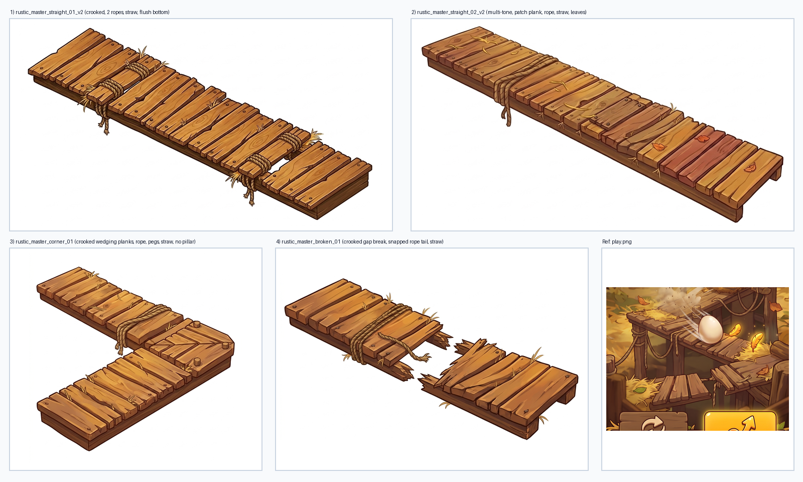
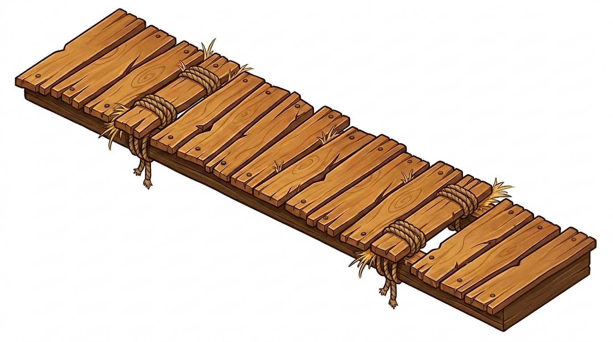
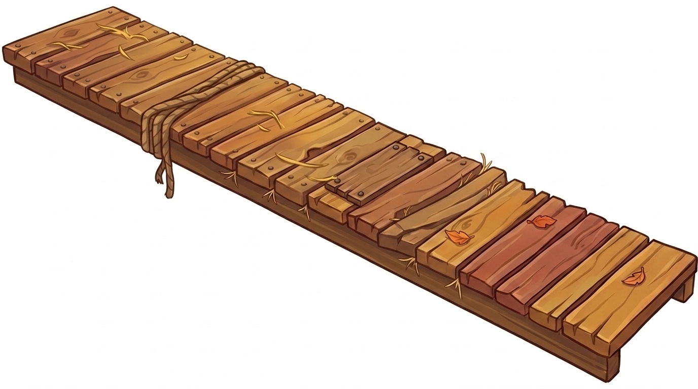
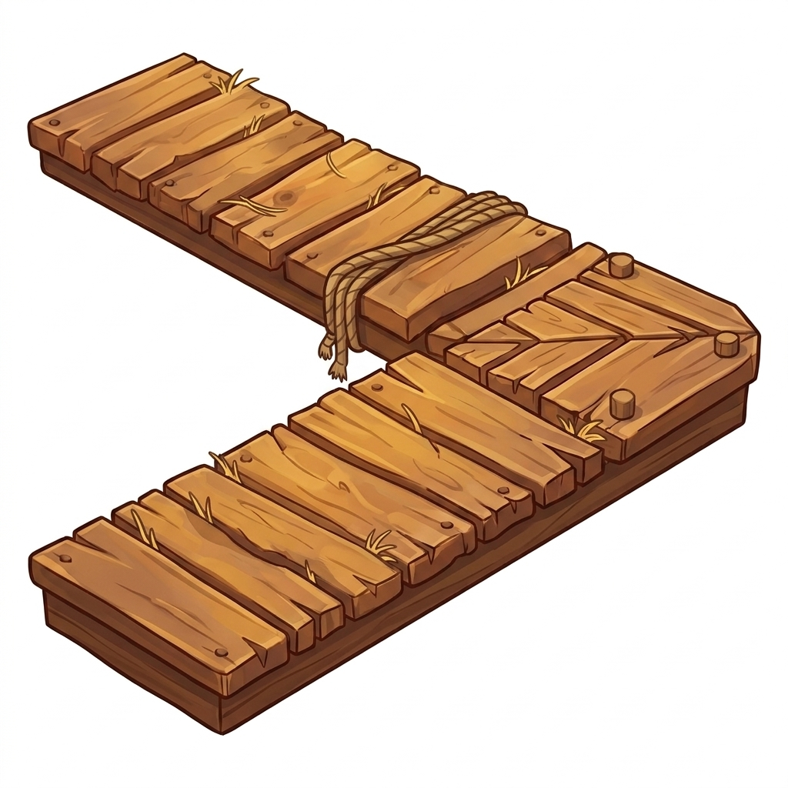
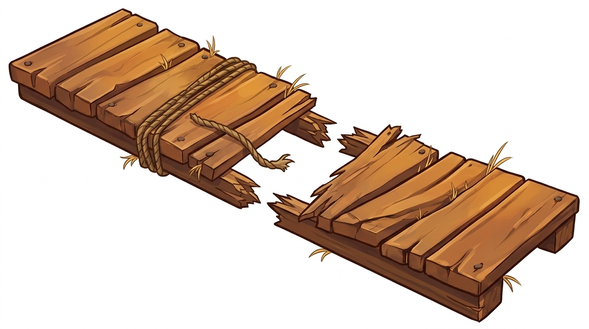
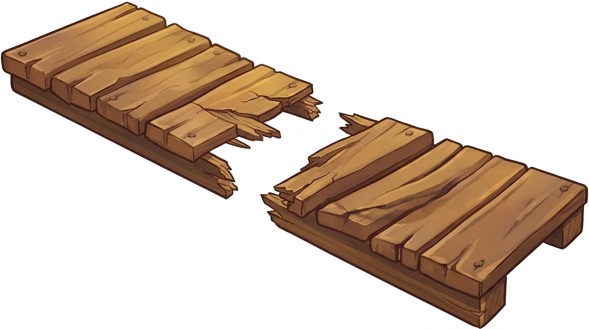
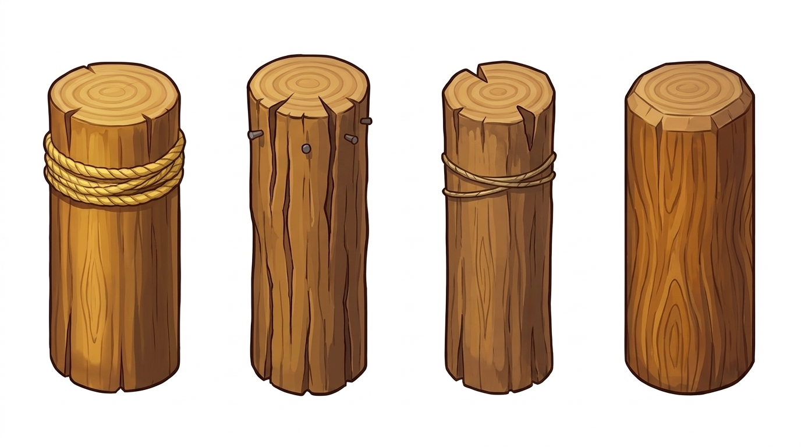

# Rustic Road Master Asset Samples

검토용 나무 다리 마스터 시안 모음입니다.

## 1. 통합 비교 시트 (vs `play.png`)

## 2. 직선 다리 마스터 1 (`rustic_master_straight_01_v2`)
- 삐뚤어진 판자 간섭 + 늘어진 밧줄 2세트 + 틈새 지푸라기 + 기둥/발 블록 없는 하단 빔

## 3. 직선 다리 마스터 2 (`rustic_master_straight_02_v2`)
- 다색 목재 톤 + 덧댄 보수 판자 + 밧줄 코일 + 지푸라기/낙엽 *(우하단 끝 받침 블록 1개 잔존)*

## 4. 코너 다리 (`rustic_master_corner_01`)
- 기둥·하단 발 블록 제거 + 삐뚤어진 끼움 판자 + 나무 핀 + 코너 밧줄·지푸라기

## 5. 부러진 다리 (`rustic_master_broken_01`)
- 끊어진 틈새로 삐뚤게 쏠린 판자 + 끊긴 밧줄 꼬리 + 지푸라기 *(우하단 끝 블록 잔존)*

### 참고: 직전 파단 초안 (`organic_master_broken_01_v2`)

## 6. 분리형 나무 기둥 4종 (`master_pillars_01`)

